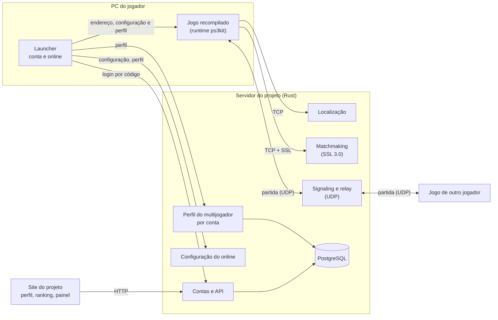
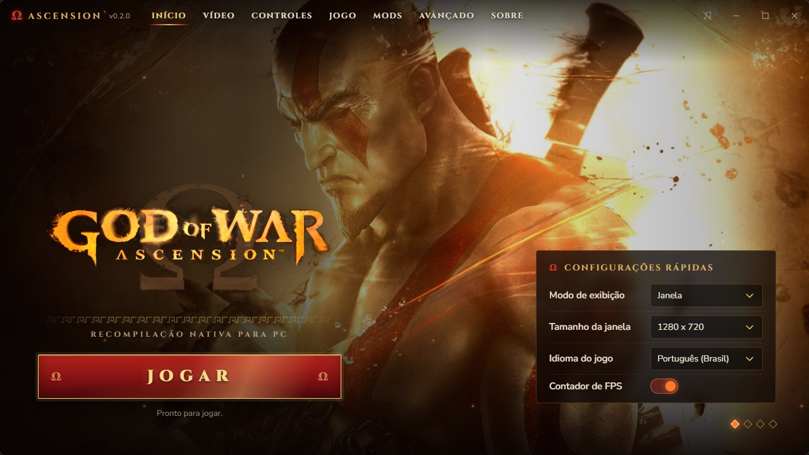
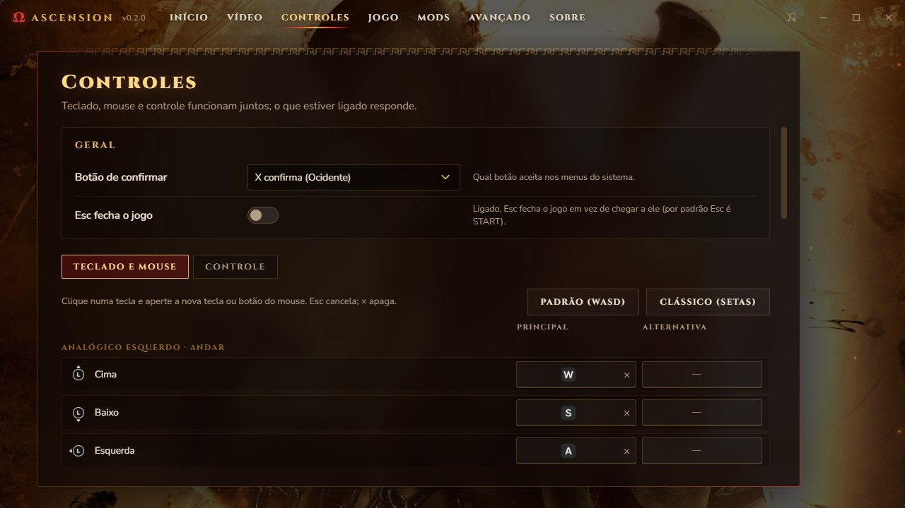

<div align="center">


# Ascension

**God of War: Ascension (PS3), recompilado para rodar nativamente no PC.**

[](docs/MILESTONES.pt-BR.md)
[](#onde-estamos)
[](#compilando)
[](LICENSE)

**Português (Brasil)** · [English](docs/README.en.md)

</div>

---

O Ascension traduz o código do jogo, do processador principal (PPU) e dos SPUs do PS3, para C++ e o compila para o seu PC, sobre o runtime do [ps3recomp](https://github.com/sp00nznet/ps3recomp). Não é um emulador: é o próprio jogo, recompilado.

> [!WARNING]
> **Ainda experimental, mas já dá para zerar.** O [iSamigor](https://github.com/iSamigor) jogou do começo ao fim no PC dele (Ryzen 7 9800X3D, RX 9070 XT). Em processadores comuns o jogo ainda é lento (~24 fps no primeiro nível num Ryzen 7 5700G, 13-21 na luta contra o chefe), e ainda pode travar. Feito para Windows; no macOS (Apple Silicon) ele voltou a rodar, por enquanto só para testes.

> [!IMPORTANT]
> **Nenhum dado do jogo está incluído.** Você precisa da sua própria cópia, a **versão europeia `BCES-01741`** (1.00), tirada do seu disco. Ninguém aqui pode te dar o jogo ou chaves. Projeto de fãs, sem ligação com a Sony Interactive Entertainment ou a Santa Monica Studio.

## Onde estamos

Novembro de 2026, no Windows (e no Mac, em testes):

- **O jogo inteiro, do boot ao fim:** o iSamigor zerou o jogo. Nos nossos testes: telas de abertura, carregamento, menus de primeiro uso, cinemática de abertura (imagem e som sincronizados), menu principal, o primeiro nível com o Kratos acorrentado e a primeira luta contra um chefe.
- **Dois renderizadores:** o RSX do [RPCS3](https://github.com/RPCS3/rpcs3) (Vulkan ou OpenGL), que desenha o jogo corretamente, e o *live draw* próprio do projeto (D3D12).
- **Launcher** em português, inglês e espanhol, com vídeo (incluindo desligar efeitos como desfoque de profundidade, motion blur e MLAA, ainda experimental), controles, idioma, legendas, melhorias e o **online** com a sua conta do site; **português do Brasil** com vozes e textos, montado no [site](https://gow-ascension.com.br/pt-br) a partir dos seus discos.

As mudanças de novembro estão no branch [`ascension-perf`](https://github.com/arnaldolima1/gow-ascension-pc/tree/ascension-perf) até serem medidas no Windows. Ainda não há release. Os marcos estão em [docs/MILESTONES.pt-BR.md](docs/MILESTONES.pt-BR.md) (em inglês: [MILESTONES.md](docs/MILESTONES.md)).

### Desempenho

O objetivo é rodar bem em processadores comuns, não só nos fortes. Primeiro nível, num Ryzen 7 5700G (cada número medido no Windows, na mesma cena):

| Onde | Começo de novembro | Hoje (5 de novembro) | RPCS3 |
| --- | --- | --- | --- |
| Primeiro nível, PC inteiro (8 núcleos, 16 threads) | ~21-23 fps | **~24 fps** | 35-40 fps |
| Primeiro nível, só 4 núcleos (8 threads) | ~14-15 fps | **~17-18 fps** | |
| Menu principal | ~50-55 fps | ~50-55 fps | |
| Luta contra o chefe | 13-21 fps | ainda não medida de novo | |

Num Ryzen 7 9800X3D com uma RX 9070 XT (RSX do RPCS3, Vulkan), o jogo chega a 60 fps fora das lutas e cai para cerca da metade nelas.

**O que rendeu em novembro** (cada mudança medida sozinha, com o jogo alternando entre ligado e desligado na mesma rodada, num PC de 4 núcleos):

- O código do processador principal compilado com perfil de uso real do jogo (PGO): ~6 ms a menos por quadro (~10%). Estendido ao código das SPUs e ao runtime: ~1 ms a mais.
- O thread principal do jogo com prioridade acima do normal: -2,7 ms por quadro.
- Os jobs do fim do quadro espalhados por até 4-5 SPUs: -2,1 ms por quadro.
- O thread do RSX dormindo quando a fila de comandos está vazia, em vez de girar: ~8% a menos; as SPUs escolhendo sozinhas o próximo trabalho: ~1,6% a menos.
- Mais partes do módulo de geometria das SPUs (o EDGE) em código nativo, conferidas contra o original: o job mais pesado dele ficou 28% mais rápido.

**Para onde vai o quadro agora:** o RSX saiu do caminho crítico nos dois PCs de teste (a espera dele entre as duas passadas da geometria caiu de 9-12 ms para ~0,1 ms). Hoje o quadro é ~55% o EDGE (o módulo 218 das SPUs), mais os jobs de renderização no começo e no fim. Dentro do EDGE, o maior desperdício achado são as interrupções do gerenciador de jobs no meio de cada job: custam tanto quanto o código do próprio job.

**Próximos passos:** diminuir essas interrupções, deixar mais leve a cópia de dados das SPUs (DMA em lista), refazer o PGO com o código novo e, depois, o culling do EDGE em código nativo (o banco de teste dele já reproduz as 412 chamadas gravadas do nível).

### Estabilidade

- **Corrigido:** o travamento no nível com as listas de geometria esperando para sempre (uma escrita do processador principal se perdia no meio de uma operação atômica de uma SPU: de 3 travamentos em 5 rodadas para nenhum em 4).
- **Corrigido:** o travamento com `CopyLocalMemory offset error` (um contador do Edge Zlib e a troca da tabela de streaming de texturas sem proteção): nenhum em 40 rodadas no nível.
- **Protegido:** comandos de vídeo corrompidos (`FIFO error: possible desync`) não derrubam mais o thread do RSX, e um draw pedindo uma quantidade absurda de vértices é descartado em vez de travar o jogo. A causa da corrupção ainda está aberta.
- **Problemas conhecidos:** logo depois da luta das criaturas, perto do braço gigante, um objeto da área aparece desenhado várias vezes, cada cópia um pouco deslocada (some quando a câmera sai dali); o jogo às vezes trava com uma lista de jobs das SPUs que não termina (`BATCHJOB: Waiting for batch job list ...`); e houve um crash silencioso ~70-105 s depois de entrar no nível em duas rodadas.

### Multijogador online (em desenvolvimento)

Os servidores originais do jogo ainda funcionam para quem joga no PS3, mas o jogo recompilado não entra na PSN. Por isso o projeto tem o próprio servidor (em Rust, ainda privado), no ar em [gow-ascension.com.br](https://gow-ascension.com.br) com o cadastro fechado por enquanto; o runtime manda para ele os nomes que o jogo procura. O servidor nunca se passa pela Sony: ele responde só o que o jogo espera, lido no código traduzido ou nas capturas do próprio jogo falando com ele. A partida usa o netcode do próprio jogo (uma malha P2P por UDP); como dois jogadores em casa quase nunca se alcançam direto (cada um atrás do seu roteador), os pacotes passam por um relay do servidor, e o jogo nem percebe.

| Passo | Estado |
| --- | --- |
| Entrar online, Online Pass | ok |
| Configuração do online (o jogo lê a nossa) | ok |
| Termos de uso, perfil do multijogador guardado na conta | ok |
| Tutorial pulado, lobby do guerreiro | ok |
| Partida rápida: localização do jogador | ok |
| Partida rápida: escolha do servidor de matchmaking | ok |
| Conexão com o matchmaking (sessão SSL 3.0) | ok |
| Dois jogadores casados numa partida, um deles host | ok (dois jogos no mesmo PC) |
| A rede da partida pelo relay do servidor | ok (dois jogos no mesmo PC) |
| Launcher: entrar na conta e jogar online | ok |
| Partida entre dois PCs pela internet | **em andamento** |
| A partida inteira, do lobby ao fim | falta |



No ar no servidor e no site: as contas, o perfil do multijogador guardado por conta, o perfil público com nível e conquistas, o ranking (vazio até haver partidas), um painel administrativo e o login do launcher por código. Planejado: os troféus do jogo assinados e conferidos pelo servidor. **"Jogar offline" vai continuar sempre funcionando**: a campanha nunca vai pedir conta.

## Jogando

Com o jogo compilado (abaixo), instale o launcher pelo `AscensionLauncher_<versão>_x64-setup.exe` das [releases](https://github.com/arnaldolima1/gow-ascension-pc/releases) e, na primeira vez, aponte a pasta `ascension` em **Avançado › Pasta do jogo**. Ele se atualiza sozinho quando sai uma versão nova.

<p align="center"></p>

JOGAR abre o jogo; o launcher se esconde até ele fechar.

- **Vídeo:** renderizador (RPCS3 Vulkan ou OpenGL, live draw), resolução interna e filtro anisotrópico (RPCS3), janela ou tela cheia (F11 ou Alt+Enter também alternam durante o jogo), tamanho da janela, proporção, escala da imagem, sincronização vertical, contador de FPS.
- **Controles:** abas para teclado e mouse (duas teclas por comando, clique e aperte a nova) e para o controle (qual botão faz cada um, zona morta). Padrão: WASD anda, setas esquivam, Espaço/J/I/L ou o mouse nos botões, Shift defende, Esc ou Enter pausa. Teclado, mouse e controle funcionam juntos.
- **Launcher** em vários idiomas; o automático segue o idioma do jogo.
- **Jogo:** idioma (inglês, português, espanhol, francês, alemão, italiano, russo, polonês, turco) e legendas, que valem mesmo depois do primeiro uso; backup automático dos saves.
- **Melhorias:** liga e desliga. Vem com **Pular intro** (direto ao carregamento, sem as telas de abertura); o botão **Abrir a pasta de melhorias** é onde entram as outras, como o **português do Brasil**, que a [página do site](https://gow-ascension.com.br/pt-br) monta no seu navegador a partir das imagens dos seus discos (nada é enviado). As melhorias incluídas são receitas: o launcher as aplica aos arquivos do seu disco, sem trazer nada do jogo.
- **Online:** entra na sua conta do site por um código (como numa TV) e liga o online; os troféus do jogo ficam na mesma aba.

<p align="center"></p>


## Compilando

```
ascension-recomp/
  ps3kit/       o runtime e o recompilador (fork do ps3recomp, com as mudanças deste projeto)
  ascension/    este repositório
  work/         o seu disco e o que sai dele (nunca vai para o git)
```

1. **Disco:** extraia a sua imagem em `work/disc` e decripte `PS3_GAME/USRDIR/EBOOT.BIN` para `EBOOT.ELF` (com o RPCS3, ou `tools/decrypt_self.py` e o seu arquivo de chaves).
2. **Tradução:** gere o código C++ com o recompilador; os scripts de `scripts/` cobrem cada etapa (veja [scripts/README.md](scripts/README.md)).
3. **Build:** Visual Studio 2022 (clang-cl), CMake e Ninja, com `.\scripts\windows\build.ps1`; o renderizador do RPCS3 se compila antes com `.\scripts\windows\build-gpu.ps1` (MSVC e Vulkan SDK). As configurações da máquina ficam num `.env` local. Um build do zero leva de 20 a 40 minutos e pede 16 GB de memória.

Os saves ficam em `gamedata/dev_hdd0`.

## Créditos

- [ps3recomp](https://github.com/sp00nznet/ps3recomp), de sp00nznet e colaboradores: o recompilador, o runtime e as bibliotecas de sistema.
- [RPCS3](https://github.com/RPCS3/rpcs3): o código do RSX usado como renderizador (GPL-2.0; um build com ele fica sob a GPL-2.0).
- [iSamigor](https://github.com/iSamigor): testes num segundo PC (Ryzen 7 9800X3D, RX 9070 XT) e correções no runtime.
- `tools/decrypt_self.py`, do port do [Twisted Metal](https://github.com/sp00nznet/twistedmetal) (MIT).
- O launcher segue o estilo do de [gow3_pc](https://github.com/FelipePrado0/gow3_pc); fonte Cinzel (SIL Open Font License).
- God of War é marca registrada da Sony Interactive Entertainment.

## Licença

MIT: veja [LICENSE](LICENSE). Vale só para o código deste repositório, não para o jogo.
