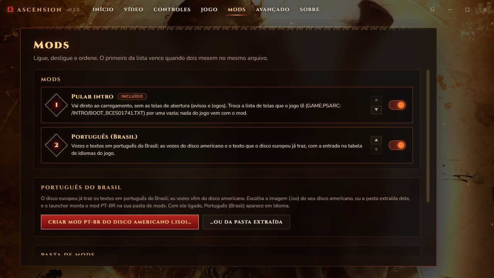

<div align="center">


# Ascension

**God of War: Ascension (PS3), recompilado para rodar nativamente no PC.**

[](docs/MILESTONES.md)
[](#onde-estamos)
[](#compilando)
[](LICENSE)

**Português (Brasil)** · [English](docs/README.en.md)

</div>

---

O Ascension traduz o código do jogo, do processador principal (PPU) e dos SPUs do PS3, para C++ e o compila para o seu PC, sobre o runtime do [ps3recomp](https://github.com/sp00nznet/ps3recomp). Não é um emulador: é o próprio jogo, recompilado.

> [!WARNING]
> **Um experimento: ainda não dá para jogar do começo ao fim.** O jogo chega ao primeiro nível e à primeira luta contra um chefe, mas ainda lento (~18-23 fps no nível, 13-21 na luta). Feito para Windows; no macOS (Apple Silicon) ele voltou a rodar, por enquanto só para testes.

> [!IMPORTANT]
> **Nenhum dado do jogo está incluído.** Você precisa da sua própria cópia, a **versão europeia `BCES-01741`** (1.00), tirada do seu disco. Ninguém aqui pode te dar o jogo ou chaves. Projeto de fãs, sem ligação com a Sony Interactive Entertainment ou a Santa Monica Studio.

## Onde estamos

Novembro de 2026, no Windows (e no Mac, em testes):

- **Do boot à primeira luta contra um chefe:** telas de abertura, carregamento, menus de primeiro uso, cinemática de abertura (imagem e som sincronizados), menu principal, o primeiro nível com o Kratos acorrentado e a primeira luta contra um chefe.
- **Dois renderizadores:** o RSX do [RPCS3](https://github.com/RPCS3/rpcs3) (Vulkan ou OpenGL), que desenha o jogo corretamente, e o *live draw* próprio do projeto (D3D12).
- **Desempenho:** menu principal a ~50-55 fps; o primeiro nível a ~22-27 fps, conforme a cena (era ~9); a luta contra o chefe a 13-21. Na mesma cena do primeiro nível, o RPCS3 faz 35-40 fps: é a distância que queremos vencer. Em novembro o quadro do primeiro nível foi medido parte por parte: dos ~50 ms, ~21 ms são as listas de geometria das SPUs (o EDGE), ~9-12 ms o jogo espera o thread do RSX entre as duas passadas dessa geometria, e o resto são os jobs de renderização no começo e no fim do quadro. Já entraram como padrão o thread do RSX dormir quando a fila de comandos está vazia, em vez de girar (~8% a menos no tempo do quadro num PC de 4 núcleos), e as SPUs escolherem sozinhas o próximo trabalho (~1,6% a menos no mesmo PC). Os próximos passos: ver exatamente o que o RSX faz naquela espera e levar o módulo de geometria das SPUs para código nativo. Partes pesadas das SPUs já rodam como código nativo, cada uma conferida contra o original: a geometria por draw (índices, skinning, normais e tangentes) e o pós-processamento que suaviza as bordas da imagem. Esses números são de um Ryzen 5 5600G com uma RX 7600; num Ryzen 7 9800X3D com uma RX 9070 XT (RSX do RPCS3, Vulkan), o jogo chega a 60 fps fora das lutas e cai para cerca da metade nelas.
- **Travamento corrigido:** o jogo às vezes congelava no nível com as listas de geometria das SPUs esperando para sempre. A causa era uma escrita do processador principal que se perdia no meio de uma operação atômica de uma SPU; corrigida, a reprodução passou de 3 travamentos em 5 rodadas para nenhum em 4.
- **Multijogador (em desenvolvimento):** com um servidor próprio do projeto (ainda privado), o jogo já entra no multijogador, chega ao lobby do guerreiro e guarda o perfil do jogador na conta. A partida online ainda não funciona.
- **Problemas conhecidos:** logo depois da luta das criaturas, perto do braço gigante, um objeto da área aparece desenhado várias vezes, cada cópia um pouco deslocada (some quando a câmera sai dali); o jogo às vezes ainda trava com uma lista de jobs das SPUs que não termina (`BATCHJOB: Waiting for batch job list ...`; conferindo se a correção acima também resolve este); e a fila de comandos de vídeo às vezes chega corrompida (`FIFO error: possible desync`), mais vezes no Mac: o thread do RSX agora se recupera em vez de travar o jogo, mas a causa ainda está aberta.
- **Launcher** em português, inglês e espanhol, com vídeo (incluindo desligar efeitos como desfoque de profundidade, motion blur e MLAA, ainda experimental), controles, idioma, legendas e mods; **português do Brasil** com vozes e textos, montado a partir do seu disco americano.

As mudanças de novembro estão no branch [`ascension-perf`](https://github.com/arnaldolima1/gow-ascension-pc/tree/ascension-perf) até serem medidas no Windows. Ainda não há release. Os marcos estão em [docs/MILESTONES.md](docs/MILESTONES.md).

<!-- Gerado por ps3kit/tools/status_map.py a partir de meta/EBOOT.imports.json e docs/status.json:
     python ..\ps3kit\tools\status_map.py --imports meta\EBOOT.imports.json --status docs\status.json --src src --src host --out docs\images\status.svg -->
<p align="center"></p>

## Jogando

Com o jogo compilado (abaixo), instale o launcher pelo `AscensionLauncher_<versão>_x64-setup.exe` das [releases](https://github.com/arnaldolima1/gow-ascension-pc/releases) e, na primeira vez, aponte a pasta `ascension` em **Avançado › Pasta do jogo**. Ele se atualiza sozinho quando sai uma versão nova.

<p align="center"></p>

JOGAR abre o jogo; o launcher se esconde até ele fechar.

- **Vídeo:** renderizador (RPCS3 Vulkan ou OpenGL, live draw), resolução interna e filtro anisotrópico (RPCS3), janela ou tela cheia (F11 ou Alt+Enter também alternam durante o jogo), tamanho da janela, proporção, escala da imagem, sincronização vertical, contador de FPS.
- **Controles:** abas para teclado e mouse (duas teclas por comando, clique e aperte a nova) e para o controle (qual botão faz cada um, zona morta). Padrão: WASD anda, setas esquivam, Espaço/J/I/L ou o mouse nos botões, Shift defende, Esc ou Enter pausa. Teclado, mouse e controle funcionam juntos.
- **Launcher** em vários idiomas; o automático segue o idioma do jogo.
- **Jogo:** idioma (inglês, português, espanhol, francês, alemão, italiano, russo, polonês, turco) e legendas, que valem mesmo depois do primeiro uso; backup automático dos saves.
- **Mods:** liga, desliga e ordena. Vem com **Pular intro** (direto ao carregamento, sem as telas de abertura); o botão **Criar mod PT-BR** monta o português do Brasil a partir da imagem do seu disco americano. Os mods incluídos são receitas: o launcher as aplica aos arquivos do seu disco, sem trazer nada do jogo.

<p align="center"></p>

<p align="center"></p>

## Compilando

```
ascension-recomp/
  ps3kit/       o runtime e o recompilador (fork do ps3recomp, com as mudanças deste projeto)
  ascension/    este repositório
  work/         o seu disco e o que sai dele (nunca vai para o git)
```

1. **Disco:** extraia a sua imagem em `work/disc` e decripte `PS3_GAME/USRDIR/EBOOT.BIN` para `EBOOT.ELF` (com o RPCS3, ou `tools/decrypt_self.py` e o seu arquivo de chaves).
2. **Tradução:** gere o código C++ com o recompilador; os scripts de `scripts/` cobrem cada etapa (veja [scripts/README.md](scripts/README.md)).
3. **Build:** Visual Studio 2022 (clang-cl), CMake e Ninja, com `.\scripts\windows\build.ps1`; o renderizador do RPCS3 se compila antes com `.\scripts\windows\build-gpu.ps1` (MSVC e Vulkan SDK). As configurações da máquina ficam num `.env` local. Um build do zero leva de 20 a 40 minutos e pede 16 GB de memória.

Os saves ficam em `gamedata/dev_hdd0`.

## Créditos

- [ps3recomp](https://github.com/sp00nznet/ps3recomp), de sp00nznet e colaboradores: o recompilador, o runtime e as bibliotecas de sistema.
- [RPCS3](https://github.com/RPCS3/rpcs3): o código do RSX usado como renderizador (GPL-2.0; um build com ele fica sob a GPL-2.0).
- [iSamigor](https://github.com/iSamigor): testes num segundo PC (Ryzen 7 9800X3D, RX 9070 XT) e correções no runtime.
- `tools/decrypt_self.py`, do port do [Twisted Metal](https://github.com/sp00nznet/twistedmetal) (MIT).
- O launcher segue o estilo do de [gow3_pc](https://github.com/FelipePrado0/gow3_pc); fonte Cinzel (SIL Open Font License).
- God of War é marca registrada da Sony Interactive Entertainment.

## Licença

MIT: veja [LICENSE](LICENSE). Vale só para o código deste repositório, não para o jogo.
