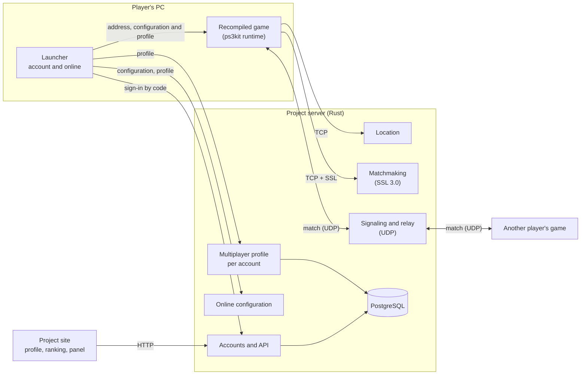

<div align="center">


# Ascension

**God of War: Ascension (PS3), recompiled to run natively on a PC.**

[](MILESTONES.md)
[](#where-it-is)
[](#building)
[](../LICENSE)

[Português (Brasil)](../README.md) · **English**

</div>

---

Ascension translates the game's code, for the PS3's main processor (PPU) and its SPUs, into C++ and compiles it for your PC, on top of the [ps3recomp](https://github.com/sp00nznet/ps3recomp) runtime. It is not an emulator: it is the game itself, recompiled.

> [!WARNING]
> **Still experimental, but it can be finished.** [iSamigor](https://github.com/iSamigor) played it from start to finish on their PC (Ryzen 7 9800X3D, RX 9070 XT). On ordinary CPUs the game is still slow (~20 fps in the boss fight on a Ryzen 7 5700G), and it can still hang. Made for Windows; on macOS (Apple Silicon) it runs again, for testing only so far.

> [!IMPORTANT]
> **No game data is included.** You need your own copy, the **European release `BCES-01741`** (1.00), taken from your disc. Nobody here can give you the game or keys. A fan project, not affiliated with Sony Interactive Entertainment or Santa Monica Studio.

## Where it is

November 2026, on Windows (and on the Mac, for testing):

- **The whole game, from boot to the end:** iSamigor finished it. In our own tests: intro screens, loading, first-use menus, the opening cinematic (picture and sound in sync), the main menu, the first level with Kratos in chains and the first boss fight.
- **Renderers:** [RPCS3](https://github.com/RPCS3/rpcs3)'s RSX (Vulkan or OpenGL), which draws the game correctly; the project's own Vulkan renderer, where the performance work is; and *live draw* (D3D12).
- **A launcher** in English, Portuguese and Spanish, with video (including turning off effects such as depth of field, motion blur and MLAA, still experimental), controls, language, subtitles, improvements and the **online** with your account from the site; **Brazilian Portuguese** voices and text, built on the [site](https://gow-ascension.com.br/en/pt-br) from your own discs.

Updated on November 10. The November changes are on the [`ascension-perf`](https://github.com/arnaldolima1/gow-ascension-pc/tree/ascension-perf) branch until they are measured on Windows. No release yet. The milestones are in [MILESTONES.md](MILESTONES.md).

### Performance

The goal is to run well on ordinary CPUs, not only on strong ones. Since November 6 the way is to **leave the PS3 model**: instead of emulating the SPUs and the RSX ever better, their work becomes native PC and GPU code, aiming at no SPU emulation left at all.

> [!NOTE]
> **A measuring mistake fixed (November 9):** our Vulkan renderer's fps counter counted every frame twice (the same frame was presented again ~1 ms later, with nothing drawn). That renderer's numbers published before are worth half. The ones below are real frames.

The boss fight right after the opening cinematic, the heaviest scene we measure, on a Ryzen 7 5700G (Windows, the project's Vulkan renderer, median of several 5 s windows):

| When | Fight fps | Video thread, per draw |
| --- | --- | --- |
| November 9, night | ~15-17 | ~17.5 µs |
| November 10, morning | ~18 | ~16.0 µs |
| November 10, afternoon | **~20** | **~15.0 µs** |

**What went in from November 6 to 10** (each piece measured, and the picture checked, before it became a default):

- **Our own Vulkan renderer** (in ps3kit), where the performance work is: the anti-aliasing the game did on the SPUs (their MLAA no longer runs) is now done on the GPU (SMAA, FXAA or MLAA), anisotropic filtering, vertices converted in batches, and a compact fps counter in the game's colours.
- **60 fps:** the game's 30 fps cap unlocked, with the game moving at the right speed, and a 60 cap. Loading, which had slowed down with the unlock, is back to ~4.5 s.
- **SPUs as native code:** three EDGE geometry modules (218, 202 and 210) now run whole as native code, each checked against the original on hundreds of jobs recorded from the game itself (identical results).
- **A lighter video thread:** 2D copies split over 3 threads (4 → 1.7 ms a frame); shader constants copied only when they change; plain video commands dispatched in blocks (-1.5 µs a draw); and textures: the game moves ~150 textures a second around video memory, and a moved texture now keeps the image already on the GPU instead of being decoded and sent again (textures 1.56 → 1.00 µs a draw).
- **macOS:** builds and opens the game again (Vulkan on MoltenVK), ~24 fps in the first level on an Apple Silicon Mac; it still hangs on some boots.

**Where the frame goes now:** in the fight, the frame is held by the thread that runs the video commands, and its biggest cost is copying the vertices the EDGE jobs have just written (~5 of each draw's ~15 µs, about 50 MB a frame).

**Next steps:** move that geometry to the GPU (positions computed there, no copy on the CPU), which should be the first big jump (an estimate of ~28-32 fps, still to be measured); then the rest of EDGE on the GPU and the other SPU modules as native code.

### Stability

- **Fixed:** on a slow PC, the video thread gave up a wait after 2 s and dropped the frame's commands; the game then stood still at the level load.
- **Fixed:** the freeze in the level with the geometry lists waiting forever (a store from the main processor lost in the middle of an SPU's atomic operation: from 3 freezes in 5 runs to none in 4).
- **Fixed:** the freeze with `CopyLocalMemory offset error` (an Edge Zlib counter, and the texture streaming table swapped without a guard): none in 40 level runs.
- **Guarded:** corrupted video commands (`FIFO error: possible desync`) no longer kill the RSX thread, and a draw asking for an absurd amount of vertices is skipped instead of crashing the game. The cause of the corruption is still open.
- **Known issues:** right after the creature fight, near the giant arm, an object of the area is drawn several times, each copy slightly offset (it goes away when the camera leaves); the game sometimes hangs on an SPU job list that never finishes (`BATCHJOB: Waiting for batch job list ...`); and twice a silent crash came ~70-105 s into the level.

### Online multiplayer (in development)

The game's original servers still work for players on a PS3, but the recompiled game does not sign in to PSN. So the project has its own server (in Rust, still private), live at [gow-ascension.com.br](https://gow-ascension.com.br) with sign-up closed for now; the runtime sends it the names the game looks for. The server never poses as Sony: it answers only what the game expects, read from the translated code or from captures of the game itself talking to it. The match uses the game's own netcode (a P2P mesh over UDP); since two players at home can hardly ever reach each other directly (each behind their router), the packets go through a relay on the server, and the game does not notice.

| Step | State |
| --- | --- |
| Going online, Online Pass | ok |
| Online configuration (the game reads ours) | ok |
| Terms of use, multiplayer profile kept on the account | ok |
| Tutorial skipped, warrior lobby | ok |
| Quick match: the player's location | ok |
| Quick match: picking the matchmaking server | ok |
| Connecting to matchmaking (SSL 3.0 session) | ok |
| Two players matched into one game, one of them host | ok (two games on one PC) |
| The match's network through the server's relay | ok (two games on one PC) |
| Launcher: signing in and playing online | ok |
| A match between two PCs over the internet | **in progress** |
| The whole match, from the lobby to the end | to do |



Live on the server and the site: accounts, the multiplayer profile kept per account, the public profile with level and achievements, the ranking (empty until there are matches), an admin panel and the launcher's sign-in by code. Planned: the game's trophies signed and checked by the server. **"Play offline" will always keep working**: the campaign will never ask for an account.

## Playing

With the game built (below), install the launcher with `AscensionLauncher_<version>_x64-setup.exe` from the [releases](https://github.com/arnaldolima1/gow-ascension-pc/releases) and, the first time, choose the `ascension` folder under **Advanced › Game folder**. It updates itself when a new version is out.

<p align="center"></p>

PLAY starts the game; the launcher hides until it closes.

- **Video:** renderer (RPCS3 Vulkan or OpenGL, live draw), internal resolution and anisotropic filtering (RPCS3), window or full screen (F11 or Alt+Enter also toggle in game), window size, aspect ratio, image scaling, VSync, FPS counter.
- **Controls:** tabs for keyboard and mouse (two keys per control: click one and press the new key) and for the controller (which button does what, dead zone). Default: WASD walks, the arrows evade, Space/J/I/L or the mouse for the face buttons, Shift blocks, Esc or Enter pauses. Keyboard, mouse and controller all work at once.
- **Launcher** in several languages; Automatic follows the game's language.
- **Game:** language (English, Portuguese, Spanish, French, German, Italian, Russian, Polish, Turkish) and subtitles, which hold after the first start too; automatic save backups.
- **Improvements:** turn them on and off. **Skip intro** comes with it (straight to the loading screen, no intro screens); **Open the improvements folder** is where the others go, such as **Brazilian Portuguese**, which the [site's page](https://gow-ascension.com.br/en/pt-br) builds in your browser from your own disc images (nothing is uploaded). The included improvements are recipes: the launcher applies them to your disc's files, carrying nothing from the game.
- **Online:** signs in to your account from the site with a code (as on a TV) and turns the online on; the game's trophies are on the same tab.

<p align="center"></p>


## Building

```
ascension-recomp/
  ps3kit/       the runtime and recompiler (a ps3recomp fork with this project's changes)
  ascension/    this repository
  work/         your disc and what is made from it (never committed)
```

1. **Disc:** extract your image into `work/disc` and decrypt `PS3_GAME/USRDIR/EBOOT.BIN` to `EBOOT.ELF` (with RPCS3, or `tools/decrypt_self.py` and your keys file).
2. **Translation:** generate the C++ code with the recompiler; the scripts in `scripts/` cover each step (see [scripts/README.md](../scripts/README.md)).
3. **Build:** Visual Studio 2022 (clang-cl), CMake and Ninja, with `.\scripts\windows\build.ps1`; RPCS3's renderer is built first with `.\scripts\windows\build-gpu.ps1` (MSVC and the Vulkan SDK). The machine's settings live in a local `.env`. A build from scratch takes 20 to 40 minutes and needs 16 GB of memory.

Saves are kept in `gamedata/dev_hdd0`.

## Credits

- [ps3recomp](https://github.com/sp00nznet/ps3recomp), by sp00nznet and contributors: the recompiler, the runtime and the system libraries.
- [RPCS3](https://github.com/RPCS3/rpcs3): its RSX code serves as a renderer (GPL-2.0; a build that includes it is GPL-2.0).
- [iSamigor](https://github.com/iSamigor): testing on a second PC (Ryzen 7 9800X3D, RX 9070 XT) and runtime fixes.
- `tools/decrypt_self.py`, from the [Twisted Metal](https://github.com/sp00nznet/twistedmetal) port (MIT).
- The launcher follows the style of [gow3_pc](https://github.com/FelipePrado0/gow3_pc)'s; Cinzel typeface (SIL Open Font License).
- God of War is a registered trademark of Sony Interactive Entertainment.

## License

MIT: see [LICENSE](../LICENSE). It covers this repository's code only, not the game.
