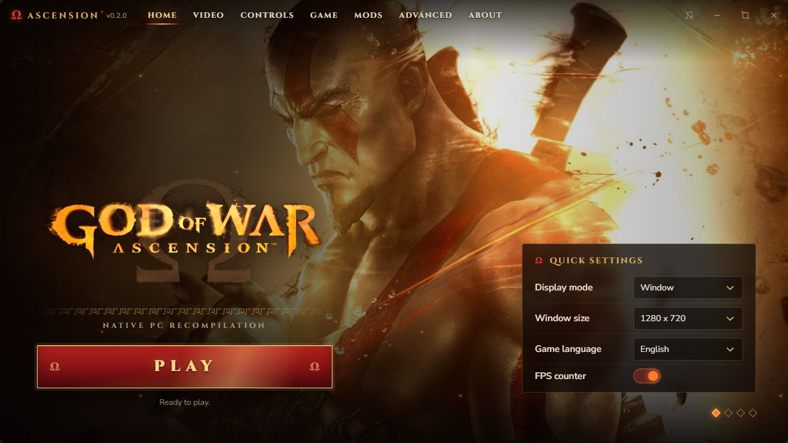
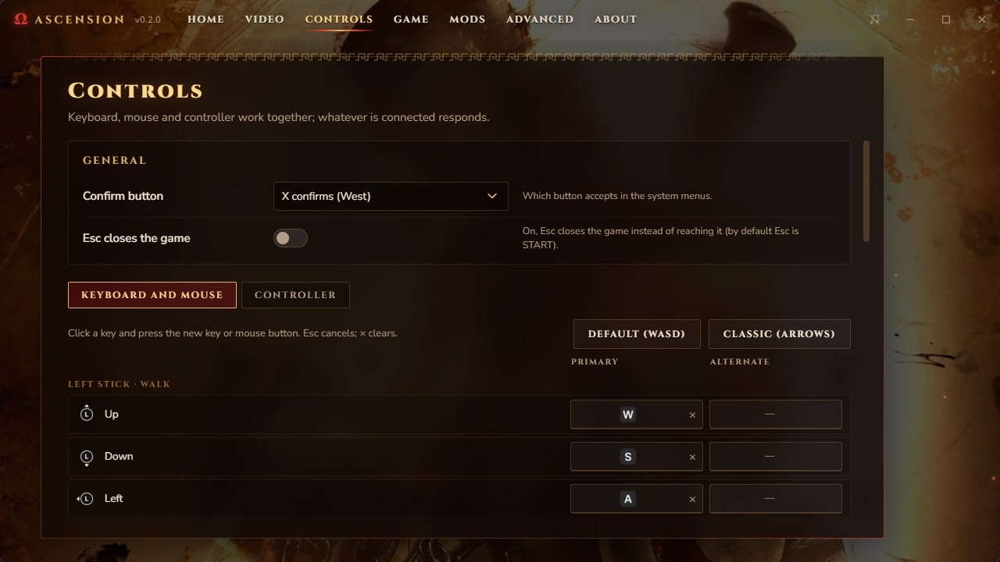
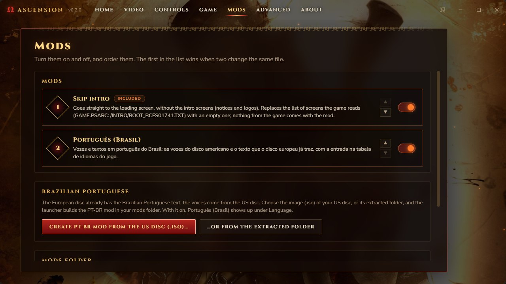

<div align="center">


# Ascension

**God of War: Ascension (PS3), recompiled to run natively on a PC.**

[](MILESTONES.md)
[](#where-it-is)
[](#building)
[](../LICENSE)

[Português (Brasil)](../README.md) · **English**

</div>

---

Ascension translates the game's code, for the PS3's main processor (PPU) and its SPUs, into C++ and compiles it for your PC, on top of the [ps3recomp](https://github.com/sp00nznet/ps3recomp) runtime. It is not an emulator: it is the game itself, recompiled. A sibling of [Sparta](https://github.com/arnaldolima1/gow-ghost-of-sparta-pc) and [Olympus](https://github.com/arnaldolima1/gow-chains-of-olympus-pc), which do the same for the PSP God of War games.

> [!WARNING]
> **An experiment: not playable from start to finish yet.** The game reaches the first level and the first boss fight, but slowly (~18-23 fps in the level, 13-21 in the fight). Windows only for now (macOS support is paused).

> [!IMPORTANT]
> **No game data is included.** You need your own copy, the **European release `BCES-01741`** (1.00), taken from your disc. Nobody here can give you the game or keys. A fan project, not affiliated with Sony Interactive Entertainment or Santa Monica Studio.

## Where it is

October 2026, on Windows:

- **From boot to the first boss fight:** intro screens, loading, first-use menus, the opening cinematic (picture and sound in sync), the main menu, the first level with Kratos in chains and the first boss fight.
- **Two renderers:** [RPCS3](https://github.com/RPCS3/rpcs3)'s RSX (Vulkan or OpenGL), which draws the game correctly, and the project's own *live draw* (D3D12).
- **Performance:** the main menu runs at ~50-55 fps; the first level at ~22-27 fps, depending on the scene (it was ~9); the boss fight at 13-21. Delaying one thread at a time and measuring how much the frame is delayed with it, the limit today is the thread that runs the video commands (RPCS3's RSX) and the game's main thread, not the SPUs or the graphics card. Heavy SPU parts already run as native code, each checked against the original: the per-draw geometry (indices, skinning, normals and tangents) and the post-process that smooths the image's edges. The focus now is making the game lighter for ordinary processors: total CPU use is down ~10% (7.2 to 6.4 cores in the menu) with no fps lost, and the next step is the wait for occlusion queries (ZCULL) on the RSX thread. These numbers are from a Ryzen 5 5600G with an RX 7600; on a Ryzen 7 9800X3D with an RX 9070 XT (RPCS3's RSX, Vulkan), the game reaches 60 fps outside fights and drops to about half in them.
- **Known issues:** right after the creature fight, near the giant arm, an object of the area is drawn several times, each copy slightly offset (it goes away when the camera leaves); and the game sometimes hangs on an SPU job list that never finishes (`BATCHJOB: Waiting for batch job list ...`).
- **A launcher** in English, Portuguese and Spanish, with video (including turning off effects such as depth of field, motion blur and MLAA, still experimental), controls, language, subtitles and mods; **Brazilian Portuguese**, voices and text, built from your own US disc.

No release yet. The milestones are in [MILESTONES.md](MILESTONES.md).

## Playing

The launcher installs the game from **your** disc and compiles it on your computer. It comes from the [releases](https://github.com/arnaldolima1/gow-ascension-pc/releases) as `AscensionLauncher_<version>_x64-setup.exe` and updates itself when a new version is out; it has no release yet (until then, build as below).

<p align="center"></p>

PLAY opens the game in its own window (on Windows, optionally inside the launcher's).

- **Installation:** choose the folder, the European `.iso` and your key file (or an `EBOOT.ELF` RPCS3 decrypted); the launcher checks the disc, decrypts, translates and compiles the game, showing each step. The image stays where it is and is mounted read-only when you play.
- **Video:** renderer (RPCS3 Vulkan or OpenGL), internal resolution, anisotropic filtering, window or full screen (F11 or Alt+Enter also toggle in game), window size, aspect ratio, image scaling, VSync, FPS counter.
- **Controls:** tabs for keyboard and mouse (two keys per control: click one and press the new key) and for the controller (which button does what, dead zone). Default: WASD walks, the arrows evade, Space/J/I/L or the mouse for the face buttons, Shift blocks, Esc or Enter pauses. Keyboard, mouse and controller all work at once.
- **Launcher** in several languages; Automatic follows the game's language.
- **Game:** language (English, Portuguese, Spanish, French, German, Italian, Russian, Polish, Turkish) and subtitles, which hold after the first start too; automatic save backups.
- **Mods:** turn them on and off, and order them. **Skip intro** comes with it (straight to the loading screen, no intro screens); **Create PT-BR mod** builds Brazilian Portuguese from your US disc image. The included mods are recipes the launcher applies to your own disc's files; none carries anything from the game.

<p align="center"></p>

<p align="center"></p>

## Building

```
ascension-recomp/
  ps3kit/       the runtime and recompiler (a ps3recomp fork with this project's changes)
  ascension/    this repository
  work/         your disc and what is made from it (never committed)
```

1. **Disc:** extract your image into `work/disc` and decrypt `PS3_GAME/USRDIR/EBOOT.BIN` to `EBOOT.ELF` (with RPCS3, or `tools/decrypt_self.py` and your keys file).
2. **Translation:** generate the C++ code with the recompiler; the scripts in `scripts/` cover each step (see [scripts/README.md](../scripts/README.md)).
3. **Build:** Visual Studio 2022 (clang-cl), CMake and Ninja, with `.\scripts\windows\build.ps1`; RPCS3's renderer is built first with `.\scripts\windows\build-gpu.ps1` (MSVC and the Vulkan SDK). The machine's settings live in a local `.env`. A build from scratch takes 20 to 40 minutes and needs 16 GB of memory.

Saves are kept in `gamedata/dev_hdd0`.

## Credits

- [ps3recomp](https://github.com/sp00nznet/ps3recomp), by sp00nznet and contributors: the recompiler, the runtime and the system libraries.
- [RPCS3](https://github.com/RPCS3/rpcs3): its RSX code serves as a renderer (GPL-2.0; a build that includes it is GPL-2.0).
- [iSamigor](https://github.com/iSamigor): testing on a second PC (Ryzen 7 9800X3D, RX 9070 XT) and runtime fixes.
- `tools/decrypt_self.py`, from the [Twisted Metal](https://github.com/sp00nznet/twistedmetal) port (MIT).
- The launcher follows the style of [gow3_pc](https://github.com/FelipePrado0/gow3_pc)'s; Cinzel typeface (SIL Open Font License).
- God of War is a registered trademark of Sony Interactive Entertainment.

## License

MIT: see [LICENSE](../LICENSE). It covers this repository's code only, not the game.
