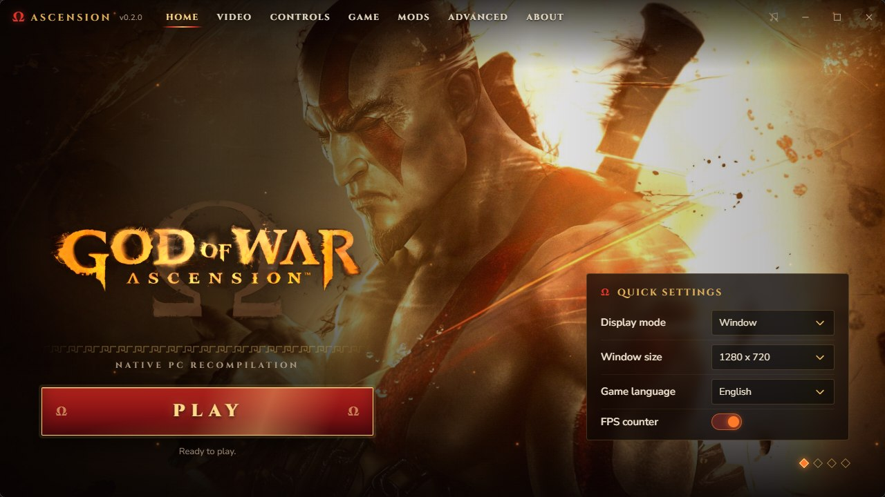
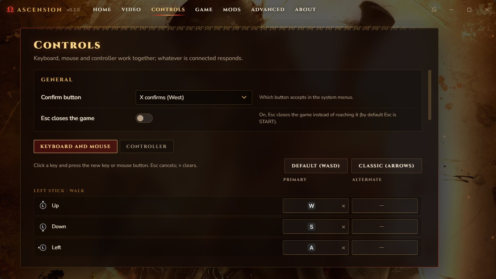
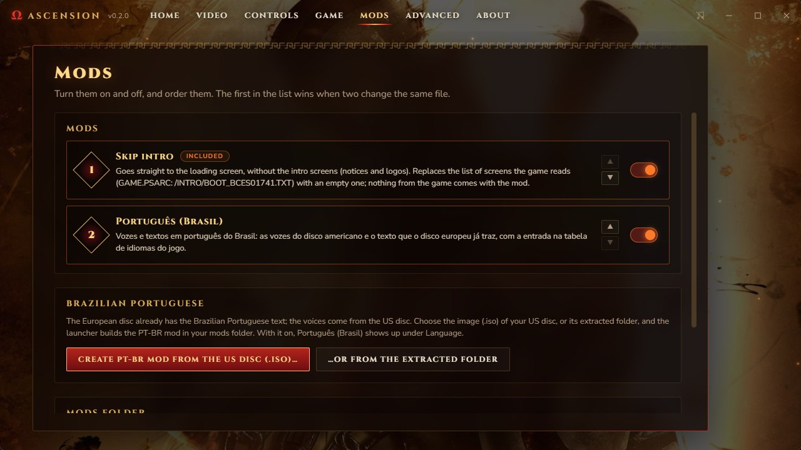

<div align="center">


# Ascension

**God of War: Ascension (PS3), recompiled to run natively on a PC.**

[](MILESTONES.md)
[](#where-it-is)
[](#building)
[](../LICENSE)

[Português (Brasil)](../README.md) · **English**

</div>

---

Ascension translates the game's code, for the PS3's main processor (PPU) and its SPUs, into C++ and compiles it for your PC, on top of the [ps3recomp](https://github.com/sp00nznet/ps3recomp) runtime. It is not an emulator: it is the game itself, recompiled. A sibling of [Sparta](https://github.com/arnaldolima1/gow-ghost-of-sparta-pc) and [Olympus](https://github.com/arnaldolima1/gow-chains-of-olympus-pc), which do the same for the PSP God of War games.

> [!WARNING]
> **An experiment: not playable from start to finish yet.** The game reaches the first level and the first boss fight, but slowly (~18-23 fps in the level, 13-21 in the fight). Made for Windows; on macOS (Apple Silicon) it runs again, for testing only so far.

> [!IMPORTANT]
> **No game data is included.** You need your own copy, the **European release `BCES-01741`** (1.00), taken from your disc. Nobody here can give you the game or keys. A fan project, not affiliated with Sony Interactive Entertainment or Santa Monica Studio.

## Where it is

November 2026, on Windows (and on the Mac, for testing):

- **From boot to the first boss fight:** intro screens, loading, first-use menus, the opening cinematic (picture and sound in sync), the main menu, the first level with Kratos in chains and the first boss fight.
- **Two renderers:** [RPCS3](https://github.com/RPCS3/rpcs3)'s RSX (Vulkan or OpenGL), which draws the game correctly, and the project's own *live draw* (D3D12).
- **Performance:** the main menu runs at ~50-55 fps; the first level at ~22-27 fps, depending on the scene (it was ~9); the boss fight at 13-21. In the same first-level scene RPCS3 makes 35-40 fps: that is the gap to close. In November the first level's frame was measured part by part: of its ~50 ms, ~21 ms are the SPUs' geometry lists (EDGE), ~9-12 ms the game waits on the RSX thread between that geometry's two passes, and the rest are the render jobs at the start and end of the frame. Now on by default: the RSX thread sleeps when its command queue is empty instead of spinning (~8% shorter frames on a 4-core PC), and the SPUs pick their next work themselves (~1.6% shorter on the same PC). Next: see exactly what the RSX does in that wait, and move the SPUs' geometry module to native code. Heavy SPU parts already run as native code, each checked against the original: the per-draw geometry (indices, skinning, normals and tangents) and the post-process that smooths the image's edges. These numbers are from a Ryzen 5 5600G with an RX 7600; on a Ryzen 7 9800X3D with an RX 9070 XT (RPCS3's RSX, Vulkan), the game reaches 60 fps outside fights and drops to about half in them.
- **A freeze fixed:** the game sometimes froze in the level with the SPUs' geometry lists waiting forever. The cause was a store from the main processor lost in the middle of an SPU's atomic operation; fixed, the repro went from 3 freezes in 5 runs to none in 4.
- **Multiplayer (in development):** with the project's own server (still private), the game already enters the multiplayer, reaches the warrior lobby and keeps the player's profile on their account. Online matches do not work yet.
- **Known issues:** right after the creature fight, near the giant arm, an object of the area is drawn several times, each copy slightly offset (it goes away when the camera leaves); the game still sometimes hangs on an SPU job list that never finishes (`BATCHJOB: Waiting for batch job list ...`; checking whether the fix above also solves this one); and the video command queue sometimes arrives corrupted (`FIFO error: possible desync`), more often on the Mac: the RSX thread now recovers instead of freezing the game, but the cause is still open.
- **A launcher** in English, Portuguese and Spanish, with video (including turning off effects such as depth of field, motion blur and MLAA, still experimental), controls, language, subtitles and mods; **Brazilian Portuguese**, voices and text, built from your own US disc.

The November changes are on the [`ascension-perf`](https://github.com/arnaldolima1/gow-ascension-pc/tree/ascension-perf) branch until they are measured on Windows. No release yet. The milestones are in [MILESTONES.md](MILESTONES.md).

## Playing

With the game built (below), install the launcher with `AscensionLauncher_<version>_x64-setup.exe` from the [releases](https://github.com/arnaldolima1/gow-ascension-pc/releases) and, the first time, choose the `ascension` folder under **Advanced › Game folder**. It updates itself when a new version is out.

<p align="center"></p>

PLAY starts the game; the launcher hides until it closes.

- **Video:** renderer (RPCS3 Vulkan or OpenGL, live draw), internal resolution and anisotropic filtering (RPCS3), window or full screen (F11 or Alt+Enter also toggle in game), window size, aspect ratio, image scaling, VSync, FPS counter.
- **Controls:** tabs for keyboard and mouse (two keys per control: click one and press the new key) and for the controller (which button does what, dead zone). Default: WASD walks, the arrows evade, Space/J/I/L or the mouse for the face buttons, Shift blocks, Esc or Enter pauses. Keyboard, mouse and controller all work at once.
- **Launcher** in several languages; Automatic follows the game's language.
- **Game:** language (English, Portuguese, Spanish, French, German, Italian, Russian, Polish, Turkish) and subtitles, which hold after the first start too; automatic save backups.
- **Mods:** turn them on and off, and order them. **Skip intro** comes with it (straight to the loading screen, no intro screens); **Create PT-BR mod** builds Brazilian Portuguese from your US disc image. The included mods are recipes the launcher applies to your own disc's files; none carries anything from the game.

<p align="center"></p>

<p align="center"></p>

## Building

```
ascension-recomp/
  ps3kit/       the runtime and recompiler (a ps3recomp fork with this project's changes)
  ascension/    this repository
  work/         your disc and what is made from it (never committed)
```

1. **Disc:** extract your image into `work/disc` and decrypt `PS3_GAME/USRDIR/EBOOT.BIN` to `EBOOT.ELF` (with RPCS3, or `tools/decrypt_self.py` and your keys file).
2. **Translation:** generate the C++ code with the recompiler; the scripts in `scripts/` cover each step (see [scripts/README.md](../scripts/README.md)).
3. **Build:** Visual Studio 2022 (clang-cl), CMake and Ninja, with `.\scripts\windows\build.ps1`; RPCS3's renderer is built first with `.\scripts\windows\build-gpu.ps1` (MSVC and the Vulkan SDK). The machine's settings live in a local `.env`. A build from scratch takes 20 to 40 minutes and needs 16 GB of memory.

Saves are kept in `gamedata/dev_hdd0`.

## Credits

- [ps3recomp](https://github.com/sp00nznet/ps3recomp), by sp00nznet and contributors: the recompiler, the runtime and the system libraries.
- [RPCS3](https://github.com/RPCS3/rpcs3): its RSX code serves as a renderer (GPL-2.0; a build that includes it is GPL-2.0).
- [iSamigor](https://github.com/iSamigor): testing on a second PC (Ryzen 7 9800X3D, RX 9070 XT) and runtime fixes.
- `tools/decrypt_self.py`, from the [Twisted Metal](https://github.com/sp00nznet/twistedmetal) port (MIT).
- The launcher follows the style of [gow3_pc](https://github.com/FelipePrado0/gow3_pc)'s; Cinzel typeface (SIL Open Font License).
- God of War is a registered trademark of Sony Interactive Entertainment.

## License

MIT: see [LICENSE](../LICENSE). It covers this repository's code only, not the game.
