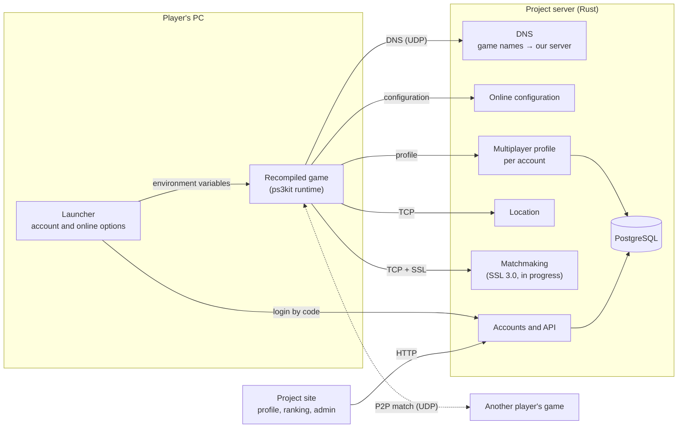

<div align="center">


# Ascension

**God of War: Ascension (PS3), recompiled to run natively on a PC.**

[](MILESTONES.md)
[](#where-it-is)
[](#building)
[](../LICENSE)

[Português (Brasil)](../README.md) · **English**

</div>

---

Ascension translates the game's code, for the PS3's main processor (PPU) and its SPUs, into C++ and compiles it for your PC, on top of the [ps3recomp](https://github.com/sp00nznet/ps3recomp) runtime. It is not an emulator: it is the game itself, recompiled.

> [!WARNING]
> **Still experimental, but it can be finished.** [iSamigor](https://github.com/iSamigor) played it from start to finish on their PC (Ryzen 7 9800X3D, RX 9070 XT). On ordinary CPUs the game is still slow (~24 fps in the first level on a Ryzen 7 5700G, 13-21 in the boss fight), and it can still hang. Made for Windows; on macOS (Apple Silicon) it runs again, for testing only so far.

> [!IMPORTANT]
> **No game data is included.** You need your own copy, the **European release `BCES-01741`** (1.00), taken from your disc. Nobody here can give you the game or keys. A fan project, not affiliated with Sony Interactive Entertainment or Santa Monica Studio.

## Where it is

November 2026, on Windows (and on the Mac, for testing):

- **The whole game, from boot to the end:** iSamigor finished it. In our own tests: intro screens, loading, first-use menus, the opening cinematic (picture and sound in sync), the main menu, the first level with Kratos in chains and the first boss fight.
- **Two renderers:** [RPCS3](https://github.com/RPCS3/rpcs3)'s RSX (Vulkan or OpenGL), which draws the game correctly, and the project's own *live draw* (D3D12).
- **A launcher** in English, Portuguese and Spanish, with video (including turning off effects such as depth of field, motion blur and MLAA, still experimental), controls, language, subtitles and mods; **Brazilian Portuguese**, voices and text, built from your own US disc.

The November changes are on the [`ascension-perf`](https://github.com/arnaldolima1/gow-ascension-pc/tree/ascension-perf) branch until they are measured on Windows. No release yet. The milestones are in [MILESTONES.md](MILESTONES.md).

### Performance

The goal is to run well on ordinary CPUs, not only on strong ones. First level, on a Ryzen 7 5700G (each number measured on Windows, in the same scene):

| Where | Early November | Now (November 5) | RPCS3 |
| --- | --- | --- | --- |
| First level, whole PC (8 cores, 16 threads) | ~21-23 fps | **~24 fps** | 35-40 fps |
| First level, 4 cores only (8 threads) | ~14-15 fps | **~17-18 fps** | |
| Main menu | ~50-55 fps | ~50-55 fps | |
| First boss fight | 13-21 fps | not measured again yet | |

On a Ryzen 7 9800X3D with an RX 9070 XT (RPCS3's RSX, Vulkan), the game reaches 60 fps outside fights and drops to about half in them.

**What paid in November** (each change measured on its own, the game switching it on and off within the same run, on a 4-core PC):

- The main processor's code compiled with a profile of the game's real use (PGO): ~6 ms shorter frames (~10%). Extended to the SPU code and the runtime: ~1 ms more.
- The game's main thread above normal priority: -2.7 ms a frame.
- The jobs at the end of the frame spread over up to 4-5 SPUs: -2.1 ms a frame.
- The RSX thread sleeping on an empty command queue instead of spinning: ~8% shorter; the SPUs picking their next work themselves: ~1.6% shorter.
- More of the SPUs' geometry module (EDGE) as native code, checked against the original: its heaviest job got 28% faster.

**Where the frame goes now:** the RSX is off the critical path on both test PCs (its wait between the geometry's two passes went from 9-12 ms to ~0.1 ms). The frame is now ~55% EDGE (SPU module 218), plus the render jobs at its start and end. Inside EDGE, the biggest waste found is the job manager's interrupts in the middle of each job: they cost as much as the job's own code.

**Next:** shrink those interrupts, make the SPUs' list DMA lighter, redo the PGO over the new code and, later, EDGE's culling as native code (its test bench already reproduces the level's 412 recorded calls).

### Stability

- **Fixed:** the freeze in the level with the geometry lists waiting forever (a store from the main processor lost in the middle of an SPU's atomic operation: from 3 freezes in 5 runs to none in 4).
- **Fixed:** the freeze with `CopyLocalMemory offset error` (an Edge Zlib counter, and the texture streaming table swapped without a guard): none in 40 level runs.
- **Guarded:** corrupted video commands (`FIFO error: possible desync`) no longer kill the RSX thread, and a draw asking for an absurd amount of vertices is skipped instead of crashing the game. The cause of the corruption is still open.
- **Known issues:** right after the creature fight, near the giant arm, an object of the area is drawn several times, each copy slightly offset (it goes away when the camera leaves); the game sometimes hangs on an SPU job list that never finishes (`BATCHJOB: Waiting for batch job list ...`); and twice a silent crash came ~70-105 s into the level.

### Online multiplayer (in development)

The game's original servers still work for players on a PS3, but the recompiled game does not sign in to PSN. So the project is writing its own server (in Rust, still private), and the runtime sends the names the game looks up to it. The server never poses as Sony: it answers only what the game expects, read in the translated code or in captures of the game talking to it. The match itself goes straight between the players (a P2P mesh over UDP, with the game's own netcode); the server handles the account, the configuration, the profile and the matchmaking.

| Step | State |
| --- | --- |
| Going online, Online Pass | ok |
| Online configuration (the game reads ours) | ok |
| Terms of use, multiplayer profile kept on the account | ok |
| Tutorial skipped, warrior lobby | ok |
| Quick match: the player's location | ok |
| Quick match: picking the matchmaking server | ok |
| Connecting to matchmaking (the game opens an SSL 3.0 session) | **in progress** |
| Lobby with other players, the match | to do |



Already working on the server and the site (locally only, nothing published): accounts, the multiplayer profile kept per account, the public profile with level and achievements, the ranking (empty until there are matches) and an admin panel. Planned: the launcher signing in with a code, like a TV, and the game's trophies signed and checked by the server. **"Play offline" will always keep working**: the campaign will never ask for an account.

## Playing

With the game built (below), install the launcher with `AscensionLauncher_<version>_x64-setup.exe` from the [releases](https://github.com/arnaldolima1/gow-ascension-pc/releases) and, the first time, choose the `ascension` folder under **Advanced › Game folder**. It updates itself when a new version is out.

<p align="center"></p>

PLAY starts the game; the launcher hides until it closes.

- **Video:** renderer (RPCS3 Vulkan or OpenGL, live draw), internal resolution and anisotropic filtering (RPCS3), window or full screen (F11 or Alt+Enter also toggle in game), window size, aspect ratio, image scaling, VSync, FPS counter.
- **Controls:** tabs for keyboard and mouse (two keys per control: click one and press the new key) and for the controller (which button does what, dead zone). Default: WASD walks, the arrows evade, Space/J/I/L or the mouse for the face buttons, Shift blocks, Esc or Enter pauses. Keyboard, mouse and controller all work at once.
- **Launcher** in several languages; Automatic follows the game's language.
- **Game:** language (English, Portuguese, Spanish, French, German, Italian, Russian, Polish, Turkish) and subtitles, which hold after the first start too; automatic save backups.
- **Mods:** turn them on and off, and order them. **Skip intro** comes with it (straight to the loading screen, no intro screens); **Create PT-BR mod** builds Brazilian Portuguese from your US disc image. The included mods are recipes the launcher applies to your own disc's files; none carries anything from the game.

<p align="center"></p>

<p align="center"></p>

## Building

```
ascension-recomp/
  ps3kit/       the runtime and recompiler (a ps3recomp fork with this project's changes)
  ascension/    this repository
  work/         your disc and what is made from it (never committed)
```

1. **Disc:** extract your image into `work/disc` and decrypt `PS3_GAME/USRDIR/EBOOT.BIN` to `EBOOT.ELF` (with RPCS3, or `tools/decrypt_self.py` and your keys file).
2. **Translation:** generate the C++ code with the recompiler; the scripts in `scripts/` cover each step (see [scripts/README.md](../scripts/README.md)).
3. **Build:** Visual Studio 2022 (clang-cl), CMake and Ninja, with `.\scripts\windows\build.ps1`; RPCS3's renderer is built first with `.\scripts\windows\build-gpu.ps1` (MSVC and the Vulkan SDK). The machine's settings live in a local `.env`. A build from scratch takes 20 to 40 minutes and needs 16 GB of memory.

Saves are kept in `gamedata/dev_hdd0`.

## Credits

- [ps3recomp](https://github.com/sp00nznet/ps3recomp), by sp00nznet and contributors: the recompiler, the runtime and the system libraries.
- [RPCS3](https://github.com/RPCS3/rpcs3): its RSX code serves as a renderer (GPL-2.0; a build that includes it is GPL-2.0).
- [iSamigor](https://github.com/iSamigor): testing on a second PC (Ryzen 7 9800X3D, RX 9070 XT) and runtime fixes.
- `tools/decrypt_self.py`, from the [Twisted Metal](https://github.com/sp00nznet/twistedmetal) port (MIT).
- The launcher follows the style of [gow3_pc](https://github.com/FelipePrado0/gow3_pc)'s; Cinzel typeface (SIL Open Font License).
- God of War is a registered trademark of Sony Interactive Entertainment.

## License

MIT: see [LICENSE](../LICENSE). It covers this repository's code only, not the game.
